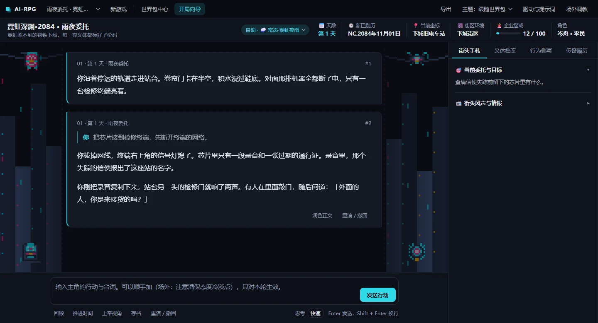

# AI-RPG-Player

**AI-powered solo text RPG engine · In development**

Describe what your character does in the browser, and an AI game master narrates the outcome. The engine tracks in-game time, character state, and changes to the world across turns. Two bundled world packs, cyberpunk and Chinese cultivation fantasy (xianxia), demonstrate how the same engine can run different settings with their own rules and interfaces.



*Screenshot of the current Chinese-language interface, taken from a local run with a fictional demo save.*

## Features

- **Play in natural language.** The story streams as it is generated, while the sidebar shows the scene, character status, and objectives. Use out-of-character feedback to adjust the narration style during a session.
- **Undo or replay turns.** The engine validates state changes before applying them and records completed turns as Git snapshots. It rolls back changes if a turn fails or is canceled.
- **Swap worlds and model backends.** World packs bundle rules, starting templates, themes, and panels. Connect a model through an OpenAI-compatible API, the Anthropic API, or a local CLI such as Codex or Claude Code.

## Architecture

| Component | Role |
| --- | --- |
| [Runtime](engine/runtime/) | Builds model context from the current scene and relevant world data, then coordinates narration, background world simulation, and model drivers. |
| [State tools](engine/tools/) | Validate model-proposed changes, apply updates atomically, and manage rollbacks and turn snapshots. |
| [World packs](packs/) | Keep setting-specific rules, save templates, and UI configuration separate from the engine. |
| [Web interface](web/) | A local Python server streams events via Server-Sent Events (SSE). The browser renders the story and status panels with vanilla JavaScript. |

## Quick start

Requires **Python 3.9+** and **Git**. Double-click `启动游戏.bat` on Windows or `启动游戏.command` on macOS, or run the launcher from the repository root.

```bash
python start.py
```

The launcher installs dependencies and opens the app in your browser. On first launch, use the setup wizard to configure your own API key or an authenticated local CLI, then select a world pack. The web server listens on localhost. Local credentials and personal saves are excluded from Git.

## Regression tests

```bash
python -m pip install -r requirements.txt
python tests/run_all.py
```

The suite runs in a temporary copy of the project and covers streaming, save isolation, world pack imports, and turn rollback. See the [engine data schema](engine/docs/schema.md) for file formats.
